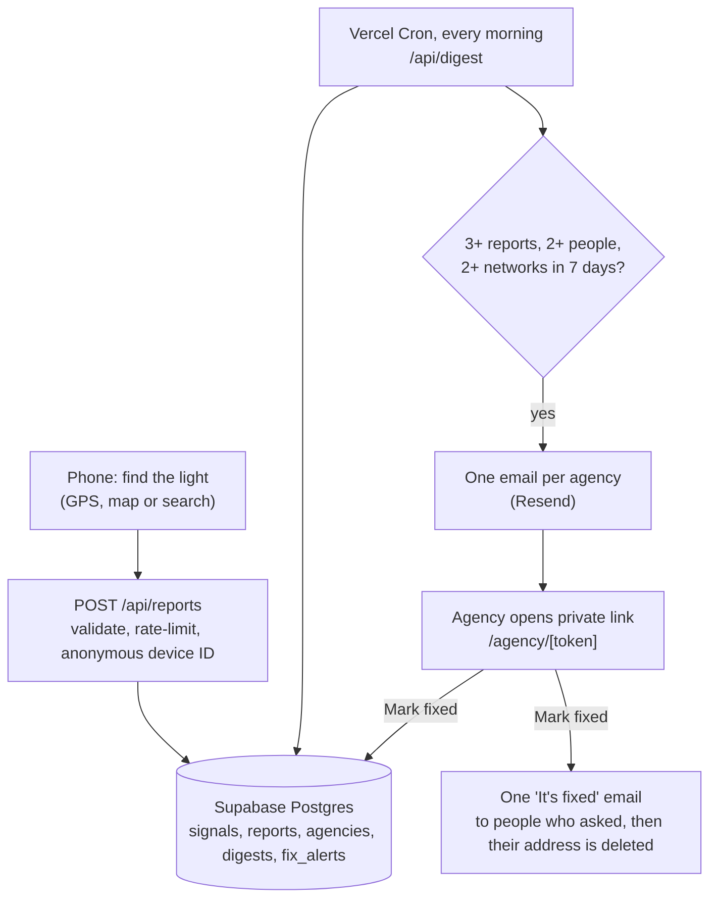

# Traffix

*It fixes traffic lights.*

**Stuck at a red light with no cross traffic? Report it in a few taps, and the app gets it to the agency that actually fixes that light.**

Covers all **327 traffic lights in Somerset County, New Jersey** (21 towns). Built by students from Hillsborough, NJ, for the 2026 Congressional App Challenge.

**Live app:** https://traffix-nj.vercel.app (works on any phone; add it to your home screen to use it like an app)

---

## The problem

Many traffic lights detect waiting cars with sensors buried in the road. When a sensor fails, the light can stay red even though nobody is coming the other way. Drivers wait minutes for nothing, waste fuel, and some give up and run the light.

Almost nobody reports it, because **nobody knows who owns the light.** In New Jersey it depends on which roads meet there:

| Road at the intersection | Who owns and fixes the light | Example |
|---|---|---|
| Interstate, US or NJ route | NJ Department of Transportation (NJDOT) | US 206 & Amwell Rd |
| County route (CR 5xx/6xx) | Somerset County Engineering | Amwell Rd (CR 514) & Beekman Ln |
| Anything else | That town's public works department | Triangle Rd & Auten Rd (Hillsborough) |

Even when people do report, a single complaint is easy to dismiss. Agencies act on **patterns**.

## What the app does

1. **Find the light.** Three ways: tap **"I'm at the light now"** (GPS picks the nearest of the county's 327 signalized intersections), **choose it on the map**, or **search by street or town** ("triangle rd", "bridgewater 22").
2. **Say what's wrong.** Stays red, completely out, stuck flashing, pedestrian button broken; plus roughly how long you waited and which way you were going. The app shows your live direction ("Driving eastbound") and fills that answer in for you.
3. **Route it automatically.** The app reads which roads meet at that light and works out the owner using the rules above.
4. **Combine reports into evidence.** When **3+ reports from 2+ different people** arrive within 7 days, the owner gets **one short summary email (a "digest")**: the problem, the direction, typical wait, and a map link.
5. **Close the loop.** The email has a private link where staff mark a light "We're on it" or "Fixed", with no account needed. The public map updates, and anyone who asked gets **one email saying it's fixed**.
6. **Show the impact.** The Impact page adds up time spent waiting and estimated CO₂ from idling (for gas cars; electric cars mostly lose time, not energy).

It feels like a familiar map app (live blue dot, a driving arrow, follow and compass modes, search), but it does one job: getting broken lights fixed. It deliberately does **not** give directions.

### Safety first
New Jersey bans handheld phone use while driving. Before a GPS report, the app asks **"Are you driving?"**. If you are, one tap saves the spot and you finish the report once parked. You can also report later from home by choosing the light on the map.

### Privacy
- No accounts and no names.
- Your location is used to find the light, and only the **light** is saved, never your coordinates.
- To tell people apart, each phone gets a random ID, and we store a **scrambled code** made from the internet connection (a salted hash), never the IP address itself.
- "Email me when it's fixed" is optional. The address is used for that one email and then **deleted**.
- You can take back your own reports at any time.

## How it works



**Test mode.** While `TEST_MODE=true` (the current setting), every email goes to the team's own inbox instead of a real agency, with the subject showing who it *would* have gone to. No agency is contacted until one agrees to receive reports.

**Agencies without email.** NJDOT and Somerset County only accept web forms, so their digests go to the team with an "Action needed: submit via form" banner, and a person submits them.

### Tech stack

| Piece | Technology |
|---|---|
| App | Next.js 16 (App Router), React 19, TypeScript, Tailwind CSS 4; installable as a Progressive Web App (PWA) |
| Map | MapLibre GL; OpenFreeMap "Positron" tiles, recolored in `src/components/mapStyle.ts` |
| Location | Browser Geolocation (live tracking) and DeviceOrientation (compass) |
| Signal data | OpenStreetMap via the Overpass API (`scripts/import-signals.ts`) |
| Database | Supabase Postgres with Row Level Security (`supabase/migrations/`) |
| Email | Resend |
| Validation | Zod |
| Tests | Vitest (unit tests) plus an end-to-end script (`scripts/smoke-test.ts`) |
| Hosting | Vercel, with Vercel Cron for the daily digest |

### Problems we had to solve

- **Divided highways.** OpenStreetMap puts a separate signal on each side of a divided road, so one intersection could show up as 4 lights. `buildSignals()` (`src/lib/signals.ts`) merges signals within 40 m (in Hillsborough alone, 64 map points became 38 real intersections).
- **Lights with no cross street.** 57 lights sit on a single road (shopping-center entrances, crosswalks, ramps), so five lights in one town were all called "US 22". `scripts/name-single-road-lights.ts` names each after the nearest other street ("US 22 near Gray Street"), and adds which side of a divided highway it's on when two still match.
- **Same town name, different places.** New Jersey has several Franklin Townships, so the importer finds Somerset County's 21 towns by their OpenStreetMap boundary IDs, not by name.
- **Who owns a light.** `ownerForRoads()` (`src/lib/jurisdiction.ts`) ranks every road through the intersection (state > county > township), so a light where US 206 crosses a county road goes to NJDOT.
- **Which way were you going?** GPS gives no direction when you're stopped at a red light. The app remembers your direction of travel from just before you stopped (`src/components/useLiveLocation.ts`).
- **Spam and fairness.** A digest needs reports from 2+ devices **and** 2+ internet connections, so clearing cookies isn't enough to fake a crowd. Repeat reports within 30 minutes are ignored, and there are daily caps per device and per connection.
- **Only real reporters can ask for alerts.** You can only sign up for a "fixed" email on a light you just reported, so nobody can sign up strangers' addresses.

## Project structure

```
src/
  app/                    Pages and API routes (Next.js App Router)
    page.tsx              The map (home)
    impact/ about/ install/
    agency/[token]/       No-login page where agency staff mark lights fixed
    api/
      reports/            Create a report; list or take back your own
      fix-alerts/         "Email me when it's fixed"
      digest/             Daily digest (run by Vercel Cron)
      agency/[token]/     Agency status updates
      signals/            Map data
  components/             Map, report screens, live location, search bar
  lib/
    jurisdiction.ts       Who owns a light
    signals.ts            Merging OpenStreetMap signals into intersections
    geo.ts                Distance, nearest light, direction of travel
    digest.ts             When a light qualifies, and the digest email
    search.ts             Street search
    store/                Database access (Supabase, or a local JSON file for offline development)
  lib/brand.ts            The app's name, in one place
data/
  signals/                Somerset County's 327 traffic lights, one file per town (generated from OpenStreetMap)
  agencies.json           Who to contact, with a source link for each
supabase/migrations/      Database tables and security rules
scripts/                  Import, database setup and the end-to-end test
```

## Running it yourself

You need Node.js 22 or newer.

```bash
npm install          # also copies MapLibre's map worker into public/maplibre
cp .env.example .env.local
npm run dev          # http://localhost:3000
```

With an empty `.env.local`, the app still runs: reports are saved to a local file and emails are shown at `/dev/outbox` instead of being sent. To use a real database and email, fill in `.env.local` (every setting is explained in `.env.example`), then:

```bash
npm run db:migrate   # create the database tables
npm run db:seed      # load the traffic lights and agencies
```

Other commands:

```bash
npm test             # unit tests
npm run smoke        # end-to-end test against a running site (refuses to run unless TEST_MODE is on)
npm run import:signals -- --somerset   # refresh all of Somerset County's lights from OpenStreetMap
npm run name:lights                    # give one-road lights a nearby landmark (run after importing)
```

**Try the whole loop locally:** report a light from three different browser windows (two of them private), open `/dev/outbox` and press **Run digest now**, then follow the "Mark signals as fixed" link in the email.

## Data sources and credits

- Traffic signals and roads: © [OpenStreetMap contributors](https://www.openstreetmap.org/copyright) (ODbL)
- Map tiles: [OpenFreeMap](https://openfreemap.org) / OpenMapTiles
- Agency contacts: each entry in `data/agencies.json` links to the page it came from and is marked `verified: false` until confirmed by phone.
- Idling estimate: US Department of Energy (¼–½ gallon per hour; we use ¼). CO₂ per gallon of gasoline: US EPA (8,887 g).
